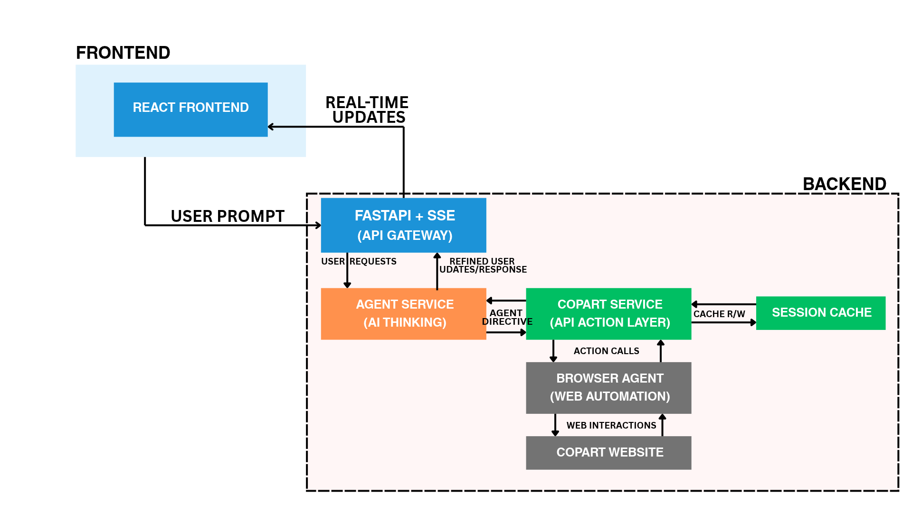

# Copart Search Assistant

This is a conversational vehicle-search assistant that turns natural-language requests into structured live Copart inventory searches. It supports follow-up questions, filter refinements, vehicle details, images, and streamed progress updates.

## Setup

### Requirements

- Windows 10 or 11
- Python 3.11 or newer
- Node.js 20 or newer
- Google Chrome (For Browser Agent)
- A Groq API key, or an OpenAI API key (check email for Groq API Key)

Clone the repository and enter its directory:

```powershell
git clone https://github.com/ochi1000/Copart-Search-Assistant.git
cd Copart-Search-Assistant
```

Create the environment file:

```powershell
Copy-Item .env.example .env
```

Add your model provider and key to `.env`. Groq is the default:

```env
LLM_PROVIDER=groq
GROQ_API_KEY=your_key

BROWSER_PROVIDER=local
HEADLESS=False
```

### Option 1: start everything

Run:

```powershell
.\run-demo.cmd
```

The script creates the Python virtual environment, installs backend and frontend dependencies, starts both services, and opens the application at `http://127.0.0.1:5173`.


### Option 2: start each service separately

Start the backend in one terminal:

```powershell
.\run-backend.cmd
```

Start the frontend in another terminal:

```powershell
.\run-frontend.cmd
```

The backend API is available at `http://127.0.0.1:8000`, and its health endpoint is `/api/v1/health`.

## Copart Search Assistant Usage

Enter a natural-language vehicle request, for example:

```text
Find 2022 or newer Toyota Camrys in Texas under 100k miles.
```

The conversation can then continue naturally:

```text
Show me more.
Only include clean-title vehicles.
Which one has the lowest mileage?
Show me the details for lot 12345678.
```

Each page refresh starts a new chat. The assistant normally shows four vehicle cards at a time so the response remains readable and stays within model token limits.

Searches use a headed Chrome session. Agent browser work is minimized; if Copart requests human verification, Chrome is restored and the assistant waits for the user to complete it before continuing.

## Architecture overview

The application is a modular monolith with clear feature boundaries:



- `frontend/` contains the main chat page, reusable assistant widget, streamed status handling, and vehicle cards.
- `backend/api/` exposes message, operation, cancellation, event-stream, and health endpoints.
- `backend/agent/` handles the conversational model, tool selection, and concise response generation.
- `backend/copart/` owns Copart-specific filters, browser automation, extraction, caching, and vehicle-detail retrieval.
- `backend/core/` contains shared events, errors, paths, and runtime context.

This separation keeps Copart-specific behavior out of the API and agent layers. Another vehicle marketplace, including another Copart-owned platform, could be added behind a similar service boundary without redesigning the chat or streaming layers, making expansion feasible with less bottlenecks.

## Key decisions

### US-focused search model

The solution is focused on United States inventory. I studied Copart's typical search flow, filter groups, Featured Items, state and yard locations, title types, damage types, vehicle attributes, purchase options, and range filters and I represented them in a validated search model. Natural-language values are normalized into the labels expected by Copart.

### Exact inventory through a browser agent

For this assignment, I prioritized results currently visible on Copart rather than generated or approximate vehicle data. A browser adapter therefore performs searches on the website, applies supported filters, validates important constraints locally, and extracts listing data and images.

Copart uses throttling, CAPTCHA challenges, and anti-bot protection. The local solution uses a human-in-the-loop flow rather than attempting to bypass those controls: when verification is detected, the browser is shown to the user and the operation waits for the action to be completed before proceeding or timing out.

### Conversational caching and pagination

The initial search reads up to the first 50 source results into a session-scoped snapshot. Follow-up requests such as "show me more" use that cached data instead of repeatedly opening Copart. When saved matches are exhausted and Copart service indicates that more inventory exists, the backend extends the search beyond the previous cached data.

### Small, grounded responses

Only four listings are presented at a time. The model supplies a short, friendly explanation around those cards. This keeps the interface readable and reduces prompt and response size due to strict token limits.

### Graceful, stream-based operations

Searches run as cancellable operations. The frontend receives progress and terminal events over Server-Sent Events, while internal browser details remain within the backend. unfullfilled searches or failures and cancellations use stable error or result contracts.

### Deployment experiment

This repository retains an experimental Docker, Railway, Vercel, and Browserless implementation. The frontend preview is available at [copart-search-assistant.vercel.app](https://copart-search-assistant.vercel.app/).

The complete deployed search could not be presented as my final submission because Copart's security service rejects Browserless access, as it should. A production deployment would require an approved or allowlisted browser-agent IP, or a live Copart-approved inventory data integration. 
The deployment work remains in the repository to demonstrate my attempted architecture and its observed limitation.

## Verification

Run backend tests:

```powershell
.\.venv\Scripts\python.exe -m unittest discover -s tests -v
```

Run frontend tests and the production build:

```powershell
cd frontend
npm test
npm run build
```
